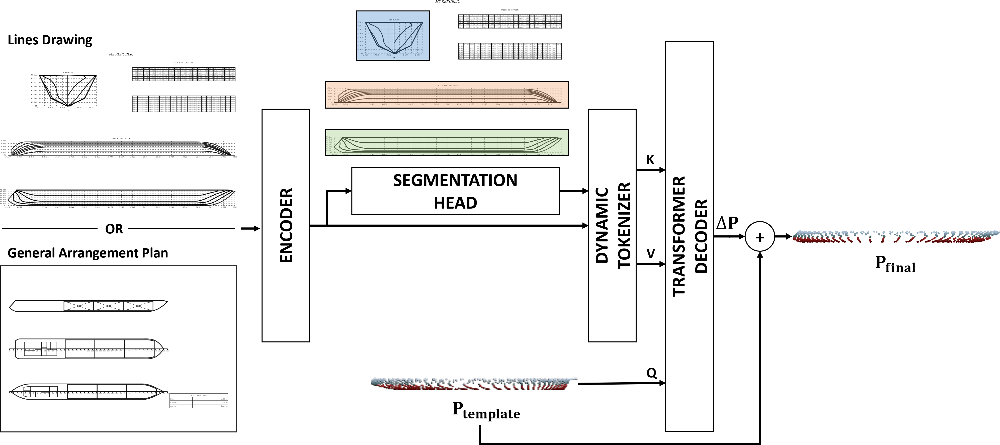

# Raster2Hull

Reconstruct a ship's **3D hull surface** (point cloud) from a **2D naval
drawing**. A single model handles two drawing types — **lines plans** and
**general arrangements (GA)** — selectable at runtime through one config flag.

The model encodes the rasterized drawing, attends over per-view bounding boxes
(body / half-breadth / sheer, or profile / top / midship), and decodes a
normalized hull point cloud with surface normals.

<p align="center">
  
</p>
<p align="center"><em>Raster2Hull architecture: 2D drawing → view-aware encoding → 3D hull point cloud.</em></p>

---

## Highlights

- **One model, multiple drawing types.** Set `dataset.drawing_type` in
  [`config.yaml`](config.yaml) to `lines`, `ga_simple`, or `ga_detailed` —
  training, inference, and the dataset loader all follow it. No code changes, no
  separate checkpoints required per type.
- **Self-contained pipeline.** Dataset split → mean-shape template → train →
  evaluate, all driven by a single YAML config.
- **Open dataset.** ML-ready `.npz` plus raw vector PDFs / PNGs and hull STL
  meshes.

---

## Installation

```bash
conda env create -f environment.yml
conda activate raster2hull
```

> CUDA 12.8 build of PyTorch (the wheels bundle their own CUDA runtime, so only
> an NVIDIA driver is needed — no system CUDA toolkit). For a pip-only setup use
> `pip install -r requirements.txt`. Tested with Python 3.10.19 /
> torch 2.9.1+cu128 / torchvision 0.24.1+cu128.

---

## Dataset

The **ShipPlan** dataset is hosted on Zenodo ([10.5281/zenodo.24101497](https://doi.org/10.5281/zenodo.24101497)). 
Download the ML-ready archive, extract it (yields an unsplit `npz/` folder), and
create the train/val/test split with `prepare_dataset.py` (ratios and seed come
from `config.yaml`):

```bash
wget https://zenodo.org/records/24101498/files/shipplan_npz.tar.gz
tar -xzf shipplan_npz.tar.gz                 # -> npz/
python scripts/prepare_dataset.py            # npz/ -> dataset/{train,val,test}/
```

`prepare_dataset.py` reads the source folder from `dataset.raw_dir` (`npz` by
default); point it elsewhere with `--source_dir /path/to/npz`. Validate the
resulting split with:

```bash
python scripts/validate_dataset.py --split-root dataset
```

---

## Configuration

All behavior is controlled by [`config.yaml`](config.yaml). Key fields:

```yaml
dataset:
  drawing_type: "ga_simple"  # lines | ga_simple | ga_detailed | ga (alias)
  dir: "dataset"             # split root (train/ val/ test/)
  raw_dir: "npz"             # unsplit .npz source for prepare_dataset.py
  img_width: 128             # rasters are resized to this width, aspect kept
  num_points: 1024           # points sampled per hull
training:
  checkpoints_dir: "checkpoints"
  batch_size: 4
  num_epochs: 1000
```

**Switching drawing type** is the only change needed to train/evaluate on a
different plan — the lines plan, the hull-only GA (`ga_simple`, as in the paper),
or the full GA with superstructure/rooms/tanks/cargo (`ga_detailed`):

```yaml
dataset:
  drawing_type: "lines"   # or ga_simple / ga_detailed
```

---

## Usage

**1. Build the mean-shape template** (used by the decoder as a deformation
prior):

```bash
python scripts/generate_mean.py   # writes mean_ship.npy (from the train split)
```

**2. Train:**

```bash
python train.py
```

Checkpoints are written to `checkpoints/`:
`checkpoint_latest.pth.tar` (resume), `checkpoint_best.pth.tar` (best val
reconstruction), and periodic `checkpoint_epoch_<n>.pth.tar`.

**3. Monitor:**

```bash
tensorboard --logdir ./checkpoints
```

**4. Evaluate** on the test set (metrics + qualitative grids against ground
truth; loads `checkpoints/checkpoint_best.pth.tar`):

```bash
python evaluate.py
```

**5. Infer** a 3D hull from a single drawing — no ground truth, no boxes (the
model's segmentation head infers the views from the image):

```bash
python infer.py --image path/to/drawing.png     # or a .pdf page
python infer.py --image plan.pdf --ply --show   # also write PLY + show 3D preview
```

Outputs land in `predictions/<image-stem>/` as `points.npy` (and optionally
`points.ply` / `render.png`). Defaults to `checkpoints/checkpoint_best.pth.tar`;
override with `--checkpoint`.

---

## Project layout

```
Raster2Hull/
├── config/               # YAML loader (SimpleNamespace)
├── config.yaml           # single source of truth for all settings
├── model/
│   ├── dataset_loader.py # DrawingDataset — drawing_type-aware .npz reader
│   ├── model.py          # ImageToPointCloudModel (encoder + attention + decoder)
│   ├── encoder.py / decoder.py / light_seg.py / ...
│   └── loss.py           # chamfer / normal / segmentation / coverage losses
├── scripts/
│   ├── generate_mean.py      # mean-shape template -> mean_ship.npy
│   └── prepare_dataset.py    # train/val/test split from unsplit npz/
├── train.py              # training loop (+ TensorBoard logging)
├── evaluate.py           # test-set metrics + qualitative grids (needs GT)
├── infer.py              # single drawing -> 3D hull (true inference, no GT)
└── README.md
```

---

## How the drawing-type switch works

Every `.npz` sample carries both drawings. The loader resolves the right keys
from `drawing_type`:

| `drawing_type` | image key | annotations key | canvas key |
|----------------|-----------|-----------------|------------|
| `lines` | `gray_lines_image` | `lines_annotations` | `lines_canvas_properties` |
| `ga_simple` | `gray_ga_simple_image` | `ga_annotations` | `ga_canvas_properties` → falls back to `lines_canvas_properties` |
| `ga_detailed` | `gray_ga_detailed_image` | `ga_annotations` | `ga_canvas_properties` → falls back to `lines_canvas_properties` |
| `ga` (alias) | `gray_ga_image` → else `gray_ga_simple_image` | `ga_annotations` | `ga_canvas_properties` → falls back to `lines_canvas_properties` |

The two GA variants share one layout (hence one annotation/canvas set):
`ga_simple` is the hull-only plan the paper uses, `ga_detailed` adds
superstructure, rooms, tanks and cargo. All types use the same three view
classes (`YZ` / `XY` / `XZ`) and the same A3 canvas, so the model and loss are
shared. See [`model/dataset_loader.py`](model/dataset_loader.py)
(`DRAWING_TYPES`).

---

## Citation

If you use this work in your research, please consider citing:

**Plain Text**
> U. Dinçer, A. Mohammed, F. Stuer-Lauridsen and E. Samur, "Raster2Hull: Learning 3D Ship Hull Geometry From Raster 2D General Arrangement and Lines Drawings," in *IEEE Access*, vol. 14, pp. 117389-117405, 2026, doi: [10.1109/ACCESS.2026.3717961](https://doi.org/10.1109/ACCESS.2026.3717961).

**BibTeX**
```bibtex
@ARTICLE{11630600,
  author={Dinçer, Uğur and Mohammed, Ahmed and Stuer-Lauridsen, Frank and Samur, Evren},
  journal={IEEE Access}, 
  title={Raster2Hull: Learning 3D Ship Hull Geometry From Raster 2D General Arrangement and Lines Drawings}, 
  year={2026},
  volume={14},
  number={},
  pages={117389-117405},
  keywords={Modeling;Planning;Marine vehicles;Geometry;Three-dimensional displays;Standards;Surfaces;Decoding;Architecture;Computer architecture;2D-to-3D generation;general arrangement plan;lines plan;point clouds;ship hull reconstruction},
  doi={10.1109/ACCESS.2026.3717961}
}
